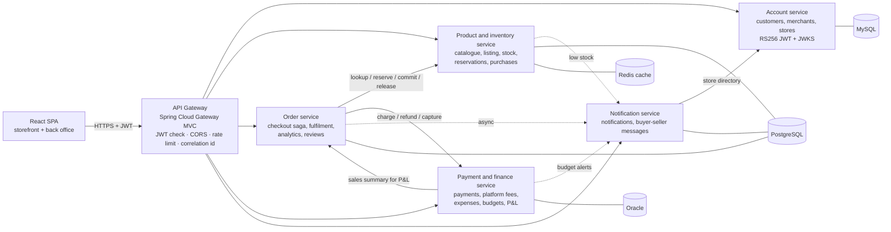
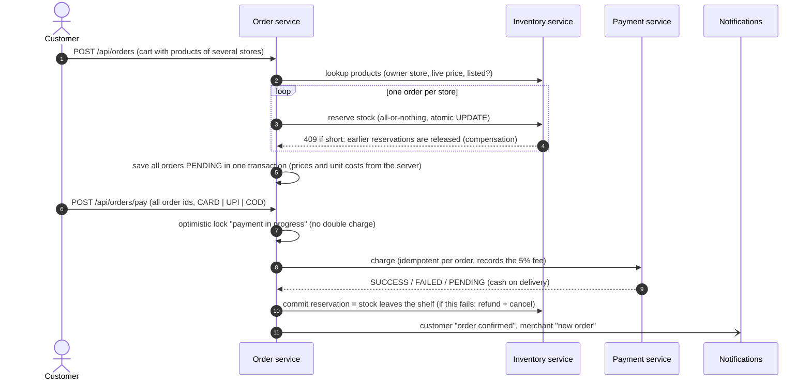
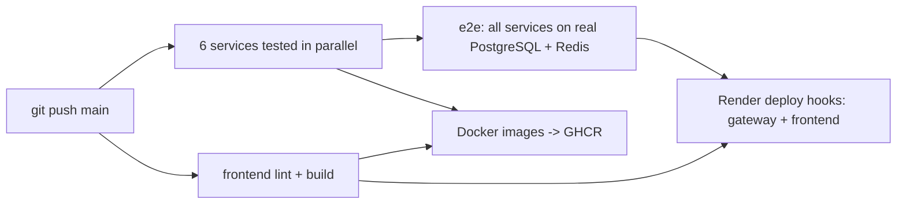

# Nexora Commerce — multi-vendor marketplace and merchant back office

A production-style **Java 21 / Spring Boot 4 microservices** platform that combines **e-commerce** and **inventory
management**:

* **Customers** shop from many independent stores in one marketplace: search and filter, one cart across stores,
  checkout once (the order is split per store), pay by card, UPI or cash on delivery, track deliveries, review what
  they bought and message sellers.
* **Merchants** sell on the marketplace and run their business from a complete back office: products with cost and
  selling price, a "list on marketplace" switch (inventory-only items stay private), stock levels with restocks,
  stock counts and an audit trail, order fulfilment with courier tracking, sales analytics, expenses, monthly budgets,
  **profit and loss**, payments received after platform fees, and **PDF / Excel reports**.
* **Administrators** see marketplace volume (GMV), the platform's commission revenue, all orders, and can suspend
  stores or customers — a suspended store and all its products disappear from the marketplace at once.

Built to show the stack used by enterprise and banking teams: **Spring Boot, Spring Security (JWT RS256 + JWKS),
Spring Data JPA / Hibernate, REST, PostgreSQL, MySQL, Oracle, Redis, Docker, Kubernetes, GitHub Actions, JUnit 5,
Mockito** — with a React front end.

| | |
|---|---|
| **Live demo** | https://enterprise-frontend-wvds.onrender.com (free hosting: the first request can take about a minute to wake the servers) |
| **API docs (Swagger, all services)** | https://enterprise-gateway.onrender.com/swagger-ui.html |
| **Accounts** | Create a **Merchant** account to open a store, and a **Customer** account to buy. Administrator: `admin` / `Admin@12345` (sign in on the Merchant tab) |
| **Test payments** | Card `4111 1111 1111 1111` approved · `4000 0000 0000 0002` declined · UPI `anything@bank` approved |

The marketplace contains **no fake data**: everything you see was listed by a real merchant account.

---

## Architecture



| Service | Port | Database | Responsibility |
|---|---|---|---|
| `api-gateway` | 8080 | – | Single entry point: routing, JWT validation, CORS, login rate limit, correlation ids, aggregated Swagger |
| `auth-service` | 8081 | **MySQL** (PostgreSQL on Render) | Customer and merchant sign-up (separate portals), store profiles and public store directory, BCrypt, **RS256** JWT with a `storeName` claim, **JWKS**, account suspension |
| `product-inventory-service` | 8082 | **PostgreSQL** + **Redis** | Each merchant's catalogue (cost, price, margin, listing switch), marketplace search, stock levels, **atomic reservations**, restocks with **weighted average cost**, stock purchases, movements audit, low-stock alerts, inventory report |
| `order-service` | 8083 | **PostgreSQL** | Checkout split into **one order per store**, **saga** (stock → payment → commit), fulfilment (ship with courier + tracking, deliver, cancel with refund), **unit cost snapshot** for profit, analytics, verified reviews, sales report |
| `payment-service` | 8084 | **Oracle** (PostgreSQL on Render) | Card / UPI / cash-on-delivery processors (**Strategy + Factory**), idempotent charges, **5% platform fee** and merchant net per payment, expenses, monthly budgets with alerts, **profit and loss**, P&L report |
| `notification-service` | 8085 | **PostgreSQL** | In-app notifications, **customer–seller messaging** with unread counters |
| `frontend` | 3000 | – | React 19 SPA: marketplace for customers and visitors, back office for merchants, console for admins |

Each service owns its data (**database per service**). On PostgreSQL every service has its own schema:
`accounts`, `inventory`, `sales`, `finance`, `messaging`.

## The checkout saga



Order states: `PENDING → CONFIRMED → SHIPPED → DELIVERED`, and `PENDING/CONFIRMED → CANCELLED`
(`OrderStatus.canTransitionTo`). Unpaid orders are cancelled after 30 minutes (`OrderExpiryJob`) and their stock
reservations expire (`ReservationExpiryJob`). A merchant can cancel a paid order: the customer is refunded and the stock
goes back on the shelf.

### How overselling is prevented
Stock is checked and changed in one conditional `UPDATE`, so the database does it atomically:

```sql
UPDATE stock_levels
   SET available_quantity = available_quantity - :qty,
       reserved_quantity  = reserved_quantity + :qty
 WHERE product_id = :productId AND available_quantity >= :qty   -- 0 rows = not enough stock -> HTTP 409
```
`InventoryApiIntegrationTest.concurrentReservationsNeverOversell` fires 10 parallel buyers at 5 units: exactly 5 succeed.

## The money: how profit is calculated

| Number | Where it comes from |
|---|---|
| **Cost of goods sold** | Each order line stores the product's **unit cost at the moment of sale** (weighted average cost of the stock). Later price or cost changes never rewrite history. |
| **Weighted average cost** | Restocking 7 units at AED 1,700 onto 3 units at AED 1,800 gives (3 × 1,800 + 7 × 1,700) / 10 = **AED 1,730** (`InventoryService.restock`). |
| **Platform fee** | 5% of every successful or cash-on-delivery payment, stored on the payment with the merchant's net amount (`PaymentService.charge`). Refunded or voided payments don't count. |
| **Operating expenses** | Rent, salaries, marketing... recorded by the merchant, with monthly budgets per category and alerts at 80% and 100%. Stock purchases are **not** expenses: they reach profit as cost of goods when the items sell. |
| **Profit and loss** | revenue − cost of goods sold = gross profit; gross profit − platform fees − operating expenses = **net profit** (`ProfitAndLossService`, monthly breakdown, PDF/Excel). |

## Security
* The **account service** signs JWTs with an **RSA private key** (RS256) and publishes the public key at
  `/.well-known/jwks.json`. The **gateway** and **every service** verify tokens with it (no shared secret anywhere).
* Roles `CUSTOMER`, `MERCHANT`, `ADMIN`. Customers and merchants sign in through **separate portals**; a merchant can
  never act as a customer and the other way round.
* **Data isolation between stores**: every merchant query is filtered by the merchant id from the token, and asking
  for another store's order, product or conversation returns 404 (so its existence is not revealed).
* Customers never see a product's cost price; inventory-only products are invisible on the marketplace (404).
* BCrypt passwords, generic login errors, login rate limiting (429), validation on every input, uniform JSON errors,
  card numbers and CVVs never stored (masked instrument only), `/internal/**` endpoints not routed by the gateway.

## Technology map

| Requirement | Where it is used |
|---|---|
| Core Java / OOP / SOLID | Records, enums with behaviour (`OrderStatus`, `ExpenseCategory`), interfaces (`PaymentProcessor`, `KeyResolver`) |
| Design patterns | Strategy + Factory (payments), Saga (checkout), Repository, DTO, Cache-aside, Observer (`@TransactionalEventListener` for low-stock and budget alerts) |
| Spring Boot / MVC / REST | 6 Spring Boot 4 services, REST controllers, validation, Swagger/OpenAPI (springdoc) |
| Hibernate / JPA / SQL | Relationships (`@OneToMany`, `@ManyToOne`, `@OneToOne @MapsId`), JPQL aggregates (`GROUP BY`, `SUM`, `year()`/`month()`), Specifications, pagination, optimistic (`@Version`) and pessimistic (`SELECT ... FOR UPDATE`) locking, unique constraints, indexes |
| PostgreSQL · MySQL · Oracle | Inventory/orders/messages · accounts · payments and finance (polyglot persistence via Spring profiles) |
| Redis | Product and category cache (`@Cacheable`, transaction-aware eviction, graceful fallback when Redis is down) |
| Spring Security + JWT | RS256 JWT, JWKS, method security (`@PreAuthorize`), gateway + service validation |
| Microservices | API gateway, database per service, REST with timeouts and token relay, async notifications |
| Reporting | Excel with Apache POI, PDF with a small dependency-free writer (`PdfReportWriter`) |
| Testing | 64 JUnit 5 / Mockito / Spring Boot Test / MockMvc tests + end-to-end test through the gateway (92 checks) |
| Docker | Multi-stage Dockerfiles, non-root containers, `docker compose` with health checks for 11 containers |
| Kubernetes | Deployments, Services, ConfigMap, Secret, PVCs, probes, resource limits, NodePorts, Kustomize |
| CI/CD | GitHub Actions: parallel tests → e2e on real PostgreSQL/Redis → Docker images to GHCR → Render deploy hooks |
| Cloud | Render (Docker web services, managed PostgreSQL and Key Value/Redis, static site) |
| Observability | Spring Boot Actuator (health, liveness/readiness, metrics), SLF4J logs with correlation ids |

## Run it

### Windows, one command (needs Docker Desktop)
```bat
cd /d %USERPROFILE%\Desktop\enterprise-order-platform && scripts\windows\run-local.cmd
```
Builds all images, starts MySQL, PostgreSQL, Oracle, Redis, the 6 services and the UI, waits for every health check
and runs the end-to-end test (which removes its own test data afterwards). Then open http://localhost:3000, create a
Merchant account, add products, and buy them with a Customer account.

### Any OS
```bash
docker compose up -d --build --wait     # UI http://localhost:3000, Swagger http://localhost:8080/swagger-ui.html
./scripts/smoke-test.sh                 # end-to-end check through the gateway (curl + jq); KEEP_TEST_DATA=1 keeps the test stores
docker compose down                     # stop (add -v to delete the data volumes)
```

### Tests
```bash
./mvnw verify          # all services: unit + integration tests (H2, MockMvc, Mockito)
cd frontend && npm ci && npm run lint && npm run build
```

### Kubernetes (Docker Desktop)
```bat
scripts\windows\k8s-deploy.cmd
kubectl -n enterprise-platform get pods
kubectl -n enterprise-platform scale deployment order-service --replicas=3
```
UI on http://localhost:30000, gateway on http://localhost:30080.

## CI/CD


The five backend services use Render auto-deploy; the gateway and frontend are deployed by the pipeline only after
all tests pass. On Render every container activates the `render` Spring profile automatically (`RENDER=true`),
which points services at each other's public URLs and the shared PostgreSQL (one schema per service).

## API overview (through the gateway)

| Who | Method and path |
|---|---|
| Everyone | `POST /api/auth/register` (`accountType` CUSTOMER or MERCHANT) · `POST /api/auth/login` · `GET /api/products?search=&categoryId=&merchantId=&minPrice=&maxPrice=&inStockOnly=` · `GET /api/products/{id}` · `GET /api/categories` · `GET /api/merchants` · `GET /api/merchants/{id}` · `GET /api/reviews?productId=` |
| Signed in | `GET/PUT /api/users/me` · `GET /api/notifications` (+ `/unread-count`, `/{id}/read`, `/read-all`) · `GET /api/conversations` · `GET /api/conversations/{id}/messages` · `POST /api/conversations/{id}/messages` · `POST /api/conversations/{id}/read` |
| Customer | `POST /api/orders` (checkout) · `POST /api/orders/pay` (pay several orders) · `POST /api/orders/{id}/pay` · `GET /api/orders` · `GET /api/orders/{id}` · `PUT /api/orders/{id}/cancel` · `POST /api/reviews` · `GET /api/reviews/mine` · `POST /api/conversations` (contact a seller) · `GET /api/payments` |
| Merchant — catalogue and stock | `GET/POST /api/merchant/products` · `PUT/DELETE /api/merchant/products/{id}` · `PATCH /api/merchant/products/{id}/listing` · `GET /api/merchant/inventory` (+ `/summary`, `/low-stock`, `/movements`) · `PUT /api/merchant/inventory/{productId}` (stock count) · `POST /api/merchant/inventory/{productId}/restock` · `GET /api/merchant/purchases` |
| Merchant — sales | `GET /api/merchant/orders` · `GET /api/merchant/orders/{id}` · `PUT /api/merchant/orders/{id}/ship` · `PUT .../deliver` · `PUT .../cancel` · `GET /api/merchant/analytics?from=&to=` · `GET /api/merchant/reviews` |
| Merchant — finance | `GET /api/merchant/payments` (+ `/summary`) · `GET/POST /api/merchant/expenses` · `PUT/DELETE /api/merchant/expenses/{id}` · `GET/PUT /api/merchant/budgets` · `POST /api/merchant/budgets/copy` · `DELETE /api/merchant/budgets/{id}` · `GET /api/merchant/finance/profit-loss?from=&to=` |
| Merchant — reports | `GET /api/merchant/reports/sales/{pdf\|xlsx}` · `/inventory/{pdf\|xlsx}` · `/profit-loss/{pdf\|xlsx}` |
| Admin | `GET /api/users?role=` · `PUT /api/users/{id}/status` · `GET /api/orders` (all) · `GET /api/orders/stats` · `GET /api/payments/platform-summary` |

## Project structure
```
services/
  auth-service/                 accounts, merchant stores, JWT RS256 + JWKS (MySQL / PostgreSQL)
  product-inventory-service/    catalogue, marketplace search, stock, reservations, purchases (PostgreSQL + Redis)
  order-service/                checkout saga, fulfilment, analytics, reviews (PostgreSQL)
  payment-service/              payments, platform fees, expenses, budgets, profit and loss (Oracle / PostgreSQL)
  notification-service/         notifications and buyer-seller messaging (PostgreSQL)
gateway/                        Spring Cloud Gateway (WebMVC): routes, JWT filter, CORS, rate limit, Swagger aggregation
frontend/                       React 19 + Vite SPA (nginx image for Docker/K8s)
k8s/                            Kubernetes manifests (kubectl apply -k k8s)
scripts/                        smoke-test.sh (end-to-end), windows/*.cmd helpers
docs/INTERVIEW-GUIDE.md         How to explain every part of this project
docker-compose.yml · render.yaml · .github/workflows/ci.yml
```

## Design decisions and known limitations
* **Schema management**: Hibernate `ddl-auto=update` keeps three database vendors simple for a portfolio project; a
  real system would use versioned migrations (Flyway/Liquibase). Version 2 uses new schema names so the old tables
  never clash with the new ones.
* **One currency (AED)** and no VAT calculation; a production marketplace would add 5% UAE VAT invoices.
* **Payouts** to merchants are shown (net after fees) but not transferred; a real platform would batch settlements.
* **Render free tier**: services sleep after 15 minutes and are reachable on public URLs; the free PostgreSQL
  database expires after 30 days unless upgraded. In Docker/Kubernetes only the gateway and UI are exposed.
* **Messaging and events** use REST + `@Async`; Kafka with the outbox pattern would add durable delivery.
* **Rate limiting** is in-memory per gateway instance; with several instances it would move to Redis.
* The JWT signing key is stored in the auth database; in a bank it would live in a vault/HSM and be rotated.
* Access tokens live 24 hours, so a suspended user's existing token keeps working until it expires (they can't sign
  in again). Production would use short-lived access tokens with refresh tokens, or a revocation list.
