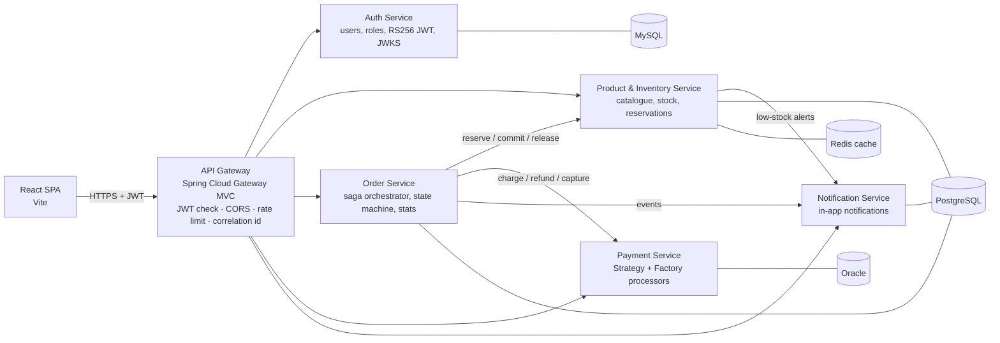
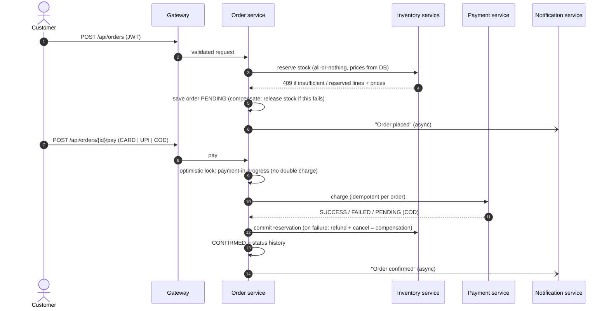
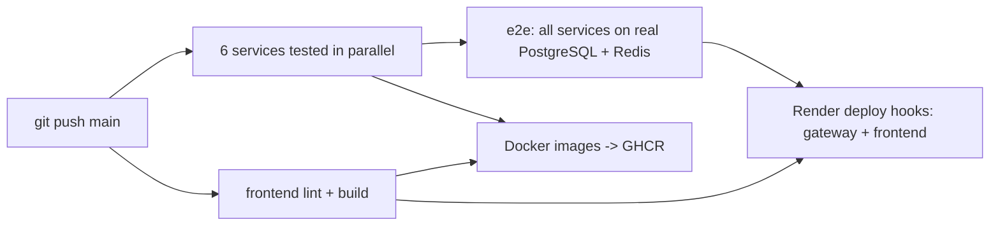

# Nexora Commerce — Enterprise Order & Inventory Platform

A production-style **Java 21 / Spring Boot 4 microservices** system for an e-commerce company: customers browse a
catalogue and place orders; stock is reserved atomically; payments go through pluggable processors; admins ship,
deliver and manage inventory; everyone gets notifications. Built to demonstrate the stack used by enterprise and
banking teams: **Spring Boot, Spring Security (JWT RS256), Spring Data JPA / Hibernate, REST, PostgreSQL, MySQL,
Oracle, Redis, Docker, Kubernetes, GitHub Actions, JUnit 5, Mockito**.

| | |
|---|---|
| **Live demo** | https://enterprise-frontend-wvds.onrender.com (free hosting: the first request can take ~1 minute to wake the servers) |
| **API docs (Swagger, all services)** | https://enterprise-gateway.onrender.com/swagger-ui.html |
| **Demo accounts** | `admin` / `Admin@12345` · `customer` / `Customer@12345` (or register a new customer) |
| **Test cards** | `4111 1111 1111 1111` approved · `4000 0000 0000 0002` declined · UPI `anything@bank` approved |

---

## Architecture



| Service | Port | Database | Responsibility |
|---|---|---|---|
| `api-gateway` | 8080 | – | Single entry point: routing, JWT validation, CORS, login rate limit, correlation ids, aggregated Swagger |
| `auth-service` | 8081 | **MySQL** (PostgreSQL on Render) | Register/login, BCrypt passwords, roles `CUSTOMER`/`ADMIN`, issues **RS256** JWTs, publishes **JWKS** |
| `product-inventory-service` | 8082 | **PostgreSQL** + **Redis** | Catalogue, categories, stock levels, **atomic reservations**, audit trail of stock movements |
| `order-service` | 8083 | **PostgreSQL** | Places orders, orchestrates the **saga** (stock → payment → confirmation), lifecycle, SQL statistics |
| `payment-service` | 8084 | **Oracle** (PostgreSQL on Render) | Card / UPI / cash-on-delivery processors (**Strategy + Factory**), idempotent charges, refunds |
| `notification-service` | 8085 | **PostgreSQL** | In-app notifications for customers and admin alerts, read/unread state |
| `frontend` | 3000 | – | React 19 single-page app (customer shop + admin back office) |

Each service owns its data (**database-per-service**; on PostgreSQL every service gets its own schema:
`auth`, `catalog`, `ordering`, `payments`, `notification`).

## The order workflow (saga orchestration)



Order states: `PENDING → CONFIRMED → SHIPPED → DELIVERED`, and `PENDING/CONFIRMED → CANCELLED`
(enforced in `OrderStatus.canTransitionTo`). Unpaid orders are cancelled after 30 minutes by a scheduler and their
stock reservation expires automatically.

### How overselling is prevented
Stock is changed with a single conditional `UPDATE`, so the database does check-and-decrement atomically:

```sql
UPDATE inventory
   SET available_quantity = available_quantity - :qty,
       reserved_quantity  = reserved_quantity + :qty
 WHERE product_id = :productId AND available_quantity >= :qty   -- 0 rows updated = not enough stock -> HTTP 409
```
`InventoryApiIntegrationTest.concurrentReservationsNeverOversell` fires 10 parallel buyers at 5 units: exactly 5 succeed.

## Security
* **Auth service** signs JWTs with an **RSA private key** (RS256) and publishes the public key at `/.well-known/jwks.json`.
* **Gateway** rejects requests to protected APIs without a valid token; **every service verifies the token again**
  using the JWKS (defense in depth, no shared secret anywhere).
* Role-based access with Spring Security `@PreAuthorize("hasRole('ADMIN')")`; customers can only see their own orders
  and payments (ownership checks in the services).
* BCrypt password hashing, generic login error messages, login rate limiting (429), validation on every input,
  uniform JSON errors, card numbers/CVV never stored (masked instrument only).
* `/internal/**` service-to-service endpoints are **not routed by the gateway**.

## Technology map

| Requirement | Where it is used |
|---|---|
| Core Java / OOP / SOLID | Records, enums with behaviour (`OrderStatus`), interfaces (`PaymentProcessor`, `KeyResolver`) |
| Design patterns | Strategy + Factory (payments), Saga (orders), Repository, DTO, Cache-aside, Observer (`@TransactionalEventListener`) |
| Spring Boot / MVC / REST | 6 Spring Boot 4 services, REST controllers, Swagger/OpenAPI (springdoc) |
| Hibernate / JPA / SQL | Entities, relationships (`@OneToMany`, `@ManyToOne`, `@OneToOne @MapsId`), JPQL, aggregates (`GROUP BY`, `SUM`), Specifications, pagination, optimistic locking (`@Version`), indexes |
| PostgreSQL · MySQL · Oracle | Catalog/orders/notifications · auth · payments (polyglot persistence via Spring profiles) |
| Redis | Product and category cache (`@Cacheable`, transaction-aware eviction, graceful fallback when Redis is down) |
| Spring Security + JWT | RS256 JWT, JWKS, method security, gateway + service validation |
| Microservices | API gateway, database per service, sync REST with timeouts + token relay, async notifications |
| Testing | 46 JUnit 5 / Mockito / Spring Boot Test / MockMvc tests + end-to-end smoke test (30 checks) |
| Docker | Multi-stage Dockerfiles, non-root containers, `docker compose` with health checks for 11 containers |
| Kubernetes | Deployments, Services, ConfigMap, Secret, PVCs, probes, resource limits, NodePorts, Kustomize |
| CI/CD | GitHub Actions: parallel tests → e2e on real PostgreSQL/Redis → Docker images to GHCR → Render deploy hooks |
| Cloud | Render (Docker web services, managed PostgreSQL and Key Value/Redis, static site) |
| Observability | Spring Boot Actuator (health, liveness/readiness, metrics), SLF4J logs with correlation ids |

## Run it

### Windows, one command (needs Docker Desktop)
```bat
cd /d %USERPROFILE%\Desktop\enterprise-order-platform && scripts\windows\run-local.cmd
```
Builds all images, starts MySQL, PostgreSQL, Oracle, Redis, the 6 services and the UI, waits for every health check
and runs the end-to-end test. Then open http://localhost:3000.

### Any OS
```bash
docker compose up -d --build --wait     # UI http://localhost:3000, Swagger http://localhost:8080/swagger-ui.html
./scripts/smoke-test.sh                 # end-to-end check through the gateway (curl + jq)
docker compose down                     # stop (add -v to delete the data volumes)
```

### Tests
```bash
./mvnw verify          # all services: unit + integration tests (H2, MockMvc, Mockito)
cd frontend && npm ci && npm run lint && npm run build
```

### Kubernetes (Docker Desktop)
```bat
scripts\windows\k8s-deploy.cmd
kubectl -n enterprise-platform get pods
kubectl -n enterprise-platform scale deployment order-service --replicas=3
```
UI on http://localhost:30000, gateway on http://localhost:30080.

## CI/CD


The five backend services use Render auto-deploy; the gateway and frontend are deployed by the pipeline only after
all tests pass. On Render every container activates the `render` Spring profile automatically (`RENDER=true`),
which points services at each other's public URLs and the shared PostgreSQL (schema per service).

## API overview (through the gateway)

| Method | Path | Access |
|---|---|---|
| POST | `/api/auth/register`, `/api/auth/login` | public |
| GET | `/api/users/me` · `/api/users` · PUT `/api/users/{id}/role` | user · admin · admin |
| GET | `/api/products?search=&categoryId=&inStockOnly=&page=&size=&sort=` · `/api/products/{id}` · `/api/categories` | public |
| POST/PUT/DELETE | `/api/products`, `/api/products/{id}`, POST `/api/categories` | admin |
| GET/PUT/POST | `/api/inventory/{productId}`, `/api/inventory/{productId}/restock`, `/api/inventory/low-stock`, `/api/inventory/{productId}/movements` | admin |
| POST | `/api/orders` · `/api/orders/{id}/pay` | customer |
| GET | `/api/orders` · `/api/orders/{id}` · `/api/orders/customer/{customerId}` | owner or admin |
| PUT | `/api/orders/{id}/cancel` · `/api/orders/{id}/status` | owner/admin · admin |
| GET | `/api/orders/stats` | admin |
| GET | `/api/payments` · `/api/payments/{id}` · `/api/payments/order/{orderId}` | owner or admin |
| GET/PATCH | `/api/notifications`, `/api/notifications/unread-count`, `/api/notifications/{id}/read`, `/api/notifications/read-all` | user |

## Project structure
```
services/
  auth-service/                 Spring Boot · Security · JPA · MySQL/PostgreSQL · JWT RS256 + JWKS
  product-inventory-service/    Spring Boot · JPA · PostgreSQL · Redis · scheduler
  order-service/                Spring Boot · JPA · PostgreSQL · RestClient · saga · scheduler
  payment-service/              Spring Boot · JPA · Oracle/PostgreSQL · Strategy + Factory
  notification-service/         Spring Boot · JPA · PostgreSQL
gateway/                        Spring Cloud Gateway (WebMVC) · JWT filter · CORS · rate limit · Swagger aggregation
frontend/                       React 19 + Vite SPA (nginx image for Docker/K8s)
k8s/                            Kubernetes manifests (kubectl apply -k k8s)
scripts/                        smoke-test.sh (e2e), windows/*.cmd helpers
docs/INTERVIEW-GUIDE.md         How to explain every part of this project
docker-compose.yml · render.yaml · .github/workflows/ci.yml
```

## Design decisions and known limitations
* **Schema management**: Hibernate `ddl-auto=update` keeps the three database vendors simple for a demo; a real
  system would use versioned migrations (Flyway/Liquibase).
* **Render free tier**: services sleep after 15 minutes and are reachable on public URLs. In Docker/Kubernetes only the
  gateway and UI are exposed; on a paid plan the services would sit on a private network.
* **Messaging**: notifications are sent asynchronously over REST; Kafka/RabbitMQ would add durable delivery.
* **Rate limiting** is in-memory per gateway instance; with several instances it would move to Redis.
* The JWT signing key is stored in the auth database; in a bank it would live in a vault/HSM and be rotated.
