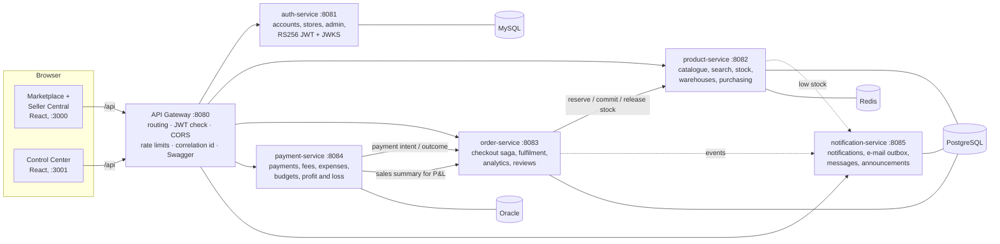
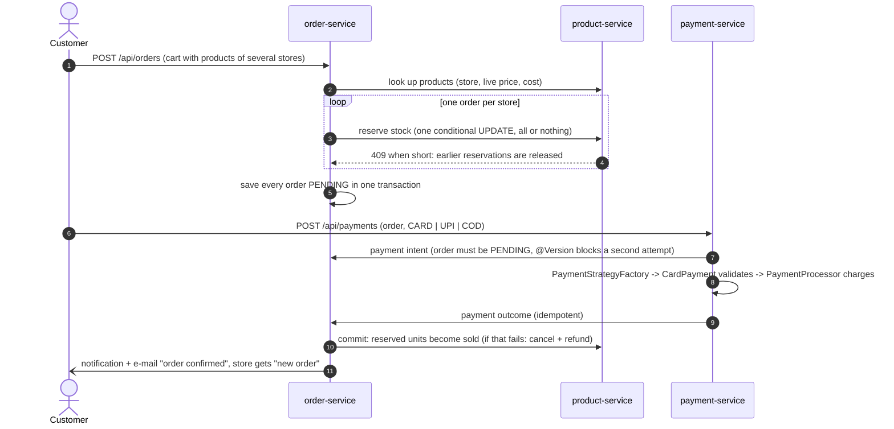
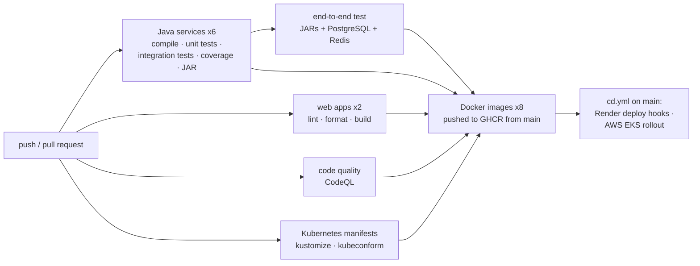

# Nexora — Marketplace & Seller Inventory Management Platform

A production-style **Java 21 / Spring Boot 4 microservices** platform: a multi-store marketplace where every store runs
its business on a full **inventory management system**, and one administrator oversees everything from a separate
console.

| Web application | Who uses it | What it does |
|---|---|---|
| **Nexora Marketplace** | customers and visitors | search with filters, product pages with verified reviews, one cart across many stores, checkout split into one order per store, card / UPI / cash on delivery, order tracking, cancellations with refunds, tax invoices, messages to stores |
| **Nexora Seller Central** (Inventory & Sales Management) | stores | products with cost, price and margin, Excel bulk upload, stock per warehouse with a full ledger, transfers, stock counts, suppliers, purchase orders and goods receipts, reorder suggestions, order desk (ship, deliver, cancel, invoices, packing slips), customers, reviews, sales and inventory analytics, payments after fees, expenses, budgets, profit and loss, PDF and Excel reports |
| **Nexora Control Center** | the one platform administrator | marketplace overview, stores and customers (suspend with a reason), every order and payment, catalogue and stock across stores, review moderation, reported conversations, announcements, sign-in security log, e-mail outbox |

The Control Center is a **separate web application** with its own sign-in endpoint: the marketplace sign-in never
accepts the administrator, and the console never accepts a store or customer account. Every web app has a dark mode.

| | |
|---|---|
| **Run everything locally** | one command on Windows: `scripts\windows\run-local.cmd` (Docker Desktop) — see [Run it](#run-it) |
| **Live demo** | marketplace https://enterprise-frontend-wvds.onrender.com · Control Center https://enterprise-admin-sikh.onrender.com · API docs https://enterprise-gateway.onrender.com/docs (free hosting: the servers sleep when nobody visits, and the first visit wakes them in up to two minutes) |
| **Demo accounts** | password `Demo-2026` · stores `alnoor`, `saharahome`, `oudamber`, `falconsports` (Seller Central) · customers `aisha`, `rahul`, `fatima`, `omar`, `maria`, `hamad` |
| **Administrator** | user `admin`, password = `ADMIN_PASSWORD` from configuration (generated into your local `.env`; never committed) |
| **Test payments** | card `4111 1111 1111 1111` approved · `4000 0000 0000 0002` declined · any UPI id approved · cash on delivery |

Built with the stack enterprise and banking teams use: **Spring Boot, Spring Security (JWT RS256 + JWKS), Spring Data
JPA / Hibernate, REST + OpenAPI, PostgreSQL, MySQL, Oracle, Redis, Docker, Kubernetes, AWS, GitHub Actions, JUnit 5,
Mockito, MockMvc, Testcontainers** — and React 19 for the three web applications.

---

## Architecture



| Service | Port | Database | Responsibility |
|---|---|---|---|
| `api-gateway` | 8080 | – | the only public API: routes `/api/**`, validates JWTs, CORS, sign-in rate limits (429), `X-Correlation-Id`, one Swagger UI for all services; never routes `/internal/**` |
| `auth-service` | 8081 | **MySQL** | customer and store sign-up, separate portals, store directory, the administrator (created from `ADMIN_PASSWORD`), login audit, account suspension, RS256 signing keys and JWKS |
| `product-service` | 8082 | **PostgreSQL + Redis** | catalogue and marketplace search with facets, the stock ledger per warehouse, reservations, transfers, counts, suppliers, purchase orders, goods receipts, reorder suggestions, Excel import |
| `order-service` | 8083 | **PostgreSQL** | checkout (one order per store), order state machine, fulfilment, cancellations, tax invoices, sales analytics, customer insights, verified reviews |
| `payment-service` | 8084 | **Oracle** | card / UPI / cash on delivery through `PaymentStrategy` + `PaymentProcessor` (mock provider), 5% platform fee, refunds, expenses, budgets with alerts, profit and loss |
| `notification-service` | 8085 | **PostgreSQL** | in-app notifications, e-mail outbox with retries, customer–store messaging, reported conversations, announcements |
| `frontend` / `admin-frontend` | 3000 / 3001 | – | nginx serving the React apps and proxying `/api` to the gateway (same origin, no CORS) |

Each service owns its data (**database per service**; on PostgreSQL every service has its own schema). Services call
each other over REST with timeouts and the caller's token; service-to-service endpoints (`/internal/**`) also need a
shared key (`INTERNAL_API_KEY`) and are not reachable through the gateway.

## The core REST API

Everything goes through the gateway (`http://localhost:8080`); [Swagger](http://localhost:8080/swagger-ui.html) lists
all of the 200-odd endpoints of the three web applications.

| Resource | Endpoints | Who |
|---|---|---|
| Products | `GET /api/products`, `GET /api/products/{id}` · `POST /api/products` · `PUT /api/products/{id}` · `DELETE /api/products/{id}` | anyone reads; a store writes its own products |
| Orders | `POST /api/orders` · `GET /api/orders/{id}` · `GET /api/orders/customer/{customerId}` · `PUT /api/orders/{id}/cancel` | the customer (the administrator can read any) |
| Inventory | `GET /api/inventory/{productId}` · `PUT /api/inventory/{productId}` (stock take) | the store that owns the product |
| Payments | `POST /api/payments` · `GET /api/payments/{id}` | the customer |

Errors always have the same JSON shape (`GlobalExceptionHandler` in every service):

```json
{ "timestamp": "2026-10-15T08:03:34Z", "status": 409, "error": "Conflict",
  "message": "Insufficient stock for 'Brass table lamp': requested 3, available 2",
  "path": "/api/orders", "correlationId": "e0e866c5-30e3-441f-8c76-9df5fc0a9301" }
```
400 adds `fieldErrors` per invalid field, 409 means a business conflict (insufficient stock, duplicate SKU, an order
that can no longer be cancelled), and another store's or customer's data answers **404** so its existence is not
revealed.

## Checkout and payment (a saga across three services)



Orders move `PENDING → CONFIRMED → SHIPPED → DELIVERED`, or `PENDING/CONFIRMED → CANCELLED`
(`OrderStatus.canTransitionTo`). Unpaid orders expire after 30 minutes (`OrderExpiryJob`) and their reservations are
released (`ReservationExpiryJob`). Cancelling a paid order refunds the card; cancelling cash on delivery voids it; the
stock goes back on the shelf either way. If the order service is unreachable after a successful charge, the payment
service keeps retrying the outcome (`OrderUpdateRetryJob`), so money and orders always end up consistent.

**No overselling**: a reservation is one statement, so the database checks and changes the row atomically —
`UPDATE inventory SET available = available - :qty, reserved = reserved + :qty WHERE product_id = :id AND available >= :qty`;
0 rows updated means 409. `concurrentReservationsNeverOversell` sends 10 parallel buyers at 5 units: exactly 5 succeed.

## Design patterns

| Pattern | Where |
|---|---|
| **Strategy** | `PaymentStrategy` with `CardPayment`, `UpiPayment`, `CashOnDelivery` (validation and charging per method); `WarehouseAllocationStrategy` decides which warehouses ship an order |
| **Factory** | `PaymentStrategyFactory` (method → strategy), `PaymentProcessorFactory` (`app.payments.provider` → processor), `ServiceClientFactory` (REST clients with timeouts) |
| **PaymentProcessor** | `MockPaymentProcessor` today; `FutureRealPaymentProcessor` is the plug-in point for a real gateway (Network International, Checkout.com, Stripe) — switching is configuration, not code |
| **Repository** | Spring Data JPA repositories with derived queries, JPQL, Criteria API filters and pessimistic / optimistic locking |
| **DTO** | Java records for every request and response; entities never leave a service (`OrderMapper`, `ProductMapper`) |
| **Saga** | checkout orchestrated by `OrderService` with compensations (release stock, refund) |
| **Observer** | `@TransactionalEventListener(AFTER_COMMIT)`: low-stock alerts, budget alerts, rating sync, e-mail outbox |
| **Outbox / retry** | e-mails are stored first and sent by a scheduled job with retries; payment outcomes are retried until delivered |

## Security
* `auth-service` signs JWTs with an **RSA private key (RS256)** and publishes the public key at `/.well-known/jwks.json`;
  the gateway and every service verify tokens themselves — no shared secret.
* Roles `CUSTOMER`, `SELLER`, `ADMIN`. Customers and stores sign in through separate portals; the administrator has a
  separate endpoint (`/api/admin/auth/login`, 5 attempts per minute, 2-hour session) and a separate web application.
* There is exactly **one administrator**, created from `ADMIN_PASSWORD` at start-up (changing it rotates the password);
  without it no administrator exists. There is no default password anywhere.
* **Store isolation**: every Seller Central query is filtered by the store id from the token, never from the request.
* Customers never see cost prices or inventory-only products; card numbers and CVVs are never stored (masked only).
* Every sign-in attempt (success or failure, IP, device) is in the security log of the Control Center.
* Secrets come from the environment: `.env` locally, a Kubernetes Secret generated from a git-ignored file, Render
  environment variables, GitHub repository secrets.

## Testing

148 JUnit tests across the six services, plus an end-to-end test that CI runs on the packaged services.

| Level | Tools | Examples |
|---|---|---|
| Unit | JUnit 5, Mockito | `OrderServiceTest` (checkout split, compensation), `PaymentStrategyTest`, `InventoryServiceTest`, `OrderStatusTest` |
| Web layer | MockMvc (`@WebMvcTest`) | `ProductControllerTest`, `ProductResourceControllerTest` (401/403, 400 field errors, 409, Location header) |
| Integration | Spring Boot Test, H2, **Testcontainers PostgreSQL** | every API with security and store isolation, `concurrentReservationsNeverOversell`, `InventoryPostgresIntegrationTest`, `GatewayIntegrationTest` |
| End-to-end | `scripts/smoke-test.mjs` (Node, no dependencies) | 139 checks through the gateway: sign-up, `/api/products`, `/api/inventory`, multi-store checkout, the 409, declined and paid cards, delivery, refund, cash on delivery, reviews, messages, notifications, finance, the administrator |

```bash
./mvnw verify                          # all services: unit, MockMvc, integration (Testcontainers needs Docker)
node scripts/smoke-test.mjs            # end-to-end against a running stack (ADMIN_PASSWORD=... adds the admin checks)
```

## Run it

### Windows, one command (Docker Desktop)
```bat
cd /d %USERPROFILE%\Desktop\enterprise-order-platform && scripts\windows\run-local.cmd
```
Generates the administrator password and the service key into `.env` (git-ignored), builds the images, starts the 12
containers (MySQL, PostgreSQL, Oracle, Redis, six services, two web apps), waits for every health check, loads the
demo the first time, and prints the addresses:

| | |
|---|---|
| Marketplace + Seller Central | http://localhost:3000 |
| Control Center | http://localhost:3001 (`admin` + the password printed by the script) |
| Swagger | http://localhost:8080/swagger-ui.html |

`scripts\windows\smoke-test.cmd` runs the end-to-end test against it; `docker compose down` stops everything.

### Save changes to GitHub, and the live demo
```bat
scripts\windows\publish.cmd
```
commits what you changed and pushes every branch. GitHub Actions tests it, and Render deploys `main` by itself once
the tests pass. To load the demo on the live site again (it replaces its stores, customers and orders, about 20
minutes on the free plan), pass the External Database URL from Render (enterprise-postgres > Connect > External):
```bat
scripts\windows\render-demo.cmd "External Database URL"
```

### Any OS
```bash
cp .env.example .env                   # then set ADMIN_PASSWORD and INTERNAL_API_KEY
docker compose up -d --build --wait
ADMIN_PASSWORD=... node scripts/demo-data.mjs http://localhost:8080   # optional demo, created through the API
```
`scripts/demo-backdate.sql` then spreads the demo orders over five months (the steps are in `run-local.cmd`).

### Kubernetes (Docker Desktop)
```bat
scripts\windows\k8s-deploy.cmd
kubectl -n enterprise-platform get pods
kubectl -n enterprise-platform scale deployment order-service --replicas=3
```
Marketplace http://localhost:30000, Control Center http://localhost:30001, gateway http://localhost:30080.
`k8s/` has `namespace.yaml` and one folder per service with its `deployment.yaml` and `service.yaml`, applied with
kustomize; probes, resource limits, rolling updates and a HorizontalPodAutoscaler for `order-service`.

### AWS
[docs/DEPLOY-AWS.md](docs/DEPLOY-AWS.md): **EC2** with Docker Compose, or **EKS** with `deploy/aws` (images from GitHub
Container Registry, load balancers for the two web applications, EBS volumes for the databases).

## CI/CD



[`.github/workflows/ci.yml`](.github/workflows/ci.yml) runs on `main`, `develop`, `feature/**` and pull requests;
[`.github/workflows/cd.yml`](.github/workflows/cd.yml) deploys when CI passes on `main`. Work happens on `feature/*`
branches merged through pull requests ([docs/GIT-WORKFLOW.md](docs/GIT-WORKFLOW.md)), planned in six sprints
([docs/AGILE.md](docs/AGILE.md)).

## Repository layout

```
services/
  auth-service/                 accounts, stores, administrator, JWT + JWKS          (MySQL)
  product-inventory-service/    product-service: catalogue, stock, purchasing         (PostgreSQL + Redis)
  order-service/                checkout, fulfilment, analytics, reviews             (PostgreSQL)
  payment-service/              payments, fees, expenses, budgets, P&L               (Oracle)
  notification-service/         notifications, e-mail outbox, messages               (PostgreSQL)
gateway/                        API gateway
frontend/                       Marketplace + Seller Central (React)
admin/                          Nexora Control Center (React, separate app)
k8s/                            Kubernetes: namespace.yaml, config/, databases/, one folder per service
deploy/aws/                     kustomize overlay for AWS EKS
scripts/                        demo data, end-to-end test, Windows helpers
docs/                           interview guide, AWS, Git workflow, Agile plan
.github/workflows/              ci.yml, cd.yml
```

## Technology map

| Requirement | Where it is used |
|---|---|
| Core Java, OOP, SOLID | records, enums with behaviour (the `OrderStatus` state machine), interfaces with several implementations (`PaymentStrategy`, `PaymentProcessor`, `WarehouseAllocationStrategy`) |
| Spring Boot, MVC, REST | six Spring Boot 4 services, Bean Validation, OpenAPI (springdoc), Actuator health probes |
| Hibernate / JPA / SQL | relationships, JPQL aggregates, Criteria API, pagination, `@Version` and `SELECT ... FOR UPDATE`, conditional updates, indexes and unique constraints, a schema per service |
| PostgreSQL · MySQL · Oracle | products, orders, notifications · accounts · payments and finance |
| Redis | cache-aside for product pages, the home page and categories; transaction-aware eviction; works when Redis is down |
| Spring Security | RS256 JWT + JWKS, `@PreAuthorize`, URL rules, internal service key, rate limiting at the gateway |
| Microservices | gateway, database per service, saga with compensation, idempotent calls, timeouts, correlation ids |
| Reporting | Excel (Apache POI) and PDF reports, UAE tax invoices (5% VAT included), packing slips |
| Testing | JUnit 5, Mockito, MockMvc, Testcontainers, a concurrency test, a 139-check end-to-end test |
| Docker | multi-stage builds, non-root containers, Compose with health checks and start-up order |
| Kubernetes | Deployments, Services, ConfigMap, Secret (kustomize), PVCs, probes, limits, rolling updates, HPA |
| Cloud | AWS (EC2, EKS, ELB, EBS), Render (Docker services, PostgreSQL, Key Value, static sites) |
| CI/CD | GitHub Actions: build, tests, coverage, CodeQL, manifest validation, images to GHCR, gated deployments |

Interview preparation: [docs/INTERVIEW-GUIDE.md](docs/INTERVIEW-GUIDE.md).
