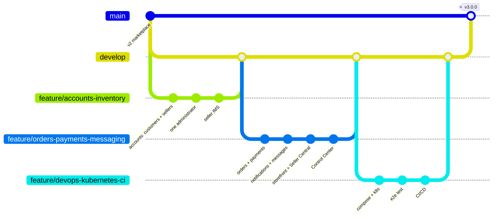

# Git workflow

Nexora uses a simple Git flow: `main` is what runs in production, `develop` collects finished work, and every piece of
work happens on its own `feature/*` branch that is merged through a pull request after CI passes.



| Branch | Purpose | Rules |
|---|---|---|
| `main` | production: every commit is deployed by `cd.yml` | changes only by pull request from `develop` (a release) or `hotfix/*`; CI must pass; tagged `vX.Y.Z` |
| `develop` | integration of finished features | changes only by pull request from `feature/*`; CI must pass |
| `feature/<topic>` | one epic or user story, e.g. `feature/orders-payments-messaging` | branched from `develop`, short-lived, deleted after the merge |
| `hotfix/<topic>` | an urgent production fix | branched from `main`, merged into `main` and back into `develop` |

## Day to day

```bash
git switch develop && git pull                       # start from the latest integrated work
git switch -c feature/purchase-order-approval        # one branch per story
# ... code, test (./mvnw verify, npm run lint), commit small steps:
git add -A && git commit -m "Purchasing: approve purchase orders above a limit"
git push -u origin feature/purchase-order-approval
gh pr create --base develop --fill                   # or "Compare & pull request" on GitHub
```

The pull request runs the whole CI pipeline (build, unit and integration tests, coverage, CodeQL, Kubernetes
manifests, the end-to-end test, Docker images). It is merged when CI is green and the checklist of the pull request
template is done; the feature branch is then deleted.

**Release**: open a pull request from `develop` to `main` ("Release 3.1.0"), merge it, and tag the merge commit:
```bash
git switch main && git pull && git tag -a v3.1.0 -m "Release 3.1.0" && git push origin v3.1.0
```
The push to `main` starts CI; when it passes, `cd.yml` deploys (Render, and AWS EKS when configured).

## Commit messages
* Imperative, with the area first: `Payments: refund cash on delivery orders as voided`.
* One logical change per commit; the body explains *why* when it is not obvious.
* Never commit secrets: `.env`, `.local/` and `k8s/config/secrets.env` are git-ignored, and the CI uses repository
  secrets.

## Protecting the branches (GitHub → Settings → Branches)
For `main` and `develop`: require a pull request before merging, require the status checks of `CI` to pass, require
branches to be up to date, block force pushes and deletions.

## This repository's history
| Branch | Sprints | Content |
|---|---|---|
| `feature/accounts-inventory` | 1-2 | customers and stores with separate portals, one administrator with its own sign-in, the seller inventory system, marketplace search |
| `feature/orders-payments-messaging` | 3-4 | checkout and the order desk, payments (Strategy + PaymentProcessor), notifications, e-mail outbox, messages, the storefront, Seller Central, the Control Center, the `/api/products` write endpoints |
| `feature/devops-kubernetes-ci` | 5-6 | Docker Compose with the planned service names, Kubernetes folders, the AWS overlay, the Node end-to-end test, CI/CD workflows, documentation |

Each was merged into `develop` with a merge commit (`--no-ff`), and `develop` into `main` as release `v3.0.0`.
